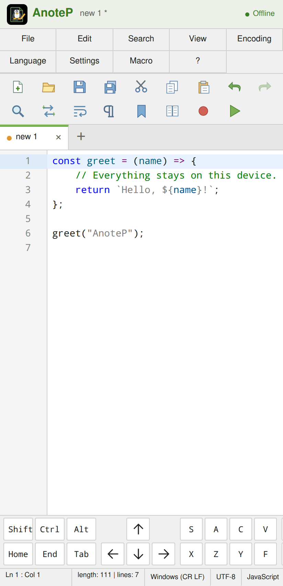
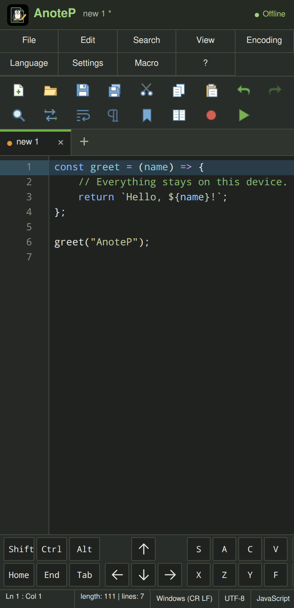

# AnoteP

A fully offline Android text and source-code editor inspired by the classic
Notepad++ interface: light menus and toolbars, green accents, document tabs,
line numbers, and an original penguin-and-notepad icon on a black background.

[Download the latest APK](https://github.com/bash-vibecoder/Notepad/releases/latest)

Android 8.0 or newer, with a current Android System WebView. The APK works on
ARM64, ARMv7, and x86 Android devices; it contains no architecture-specific native
libraries. No account, ads, analytics, or Internet permission.

<p>
  
  
</p>

## Editing

- Multiple documents with local recovery of unsaved tabs, cursor positions,
  bookmarks, preferences, and a saved macro.
- Automatic language detection from filenames, shebangs, and code content, with
  a per-document manual override.
- 121 bundled CodeMirror language modes, including C/C++, Java, Kotlin, Python,
  JavaScript, TypeScript, JSON, HTML, CSS, SQL, shell, XML, Markdown, and YAML.
- Undo/redo, folding, bracket matching, automatic bracket/tag closure, word
  completion, comments, line duplication and movement, sorting, case conversion,
  indentation, whitespace display, and trailing-space removal.
- Find/replace with match case, whole word, regular expressions, and capture-group
  replacements such as `$1`; search across open tabs or a selected local folder.
- Bookmarks, go to line, cloned split views, different documents in split views,
  a coding key panel with Shift/Ctrl/Alt and keyboard-style arrows, keyboard
  shortcuts, and local macro recording/playback.
- Two visible rows for menus and tool icons. Menus stay open while the Android
  keyboard hides.
- Light and dark themes, font zoom, word wrap, configurable indentation.

## Local files

Open and save through Android's document picker. Choose **Internal storage** or
an SD card to keep documents local. “Open folder as workspace” browses a folder
you select. AnoteP does not request broad storage access.

Supported output encodings: UTF-8, UTF-8 BOM, UTF-16 LE/BE BOM, Windows-1252,
ISO-8859-1, and ASCII. Line endings: CRLF, LF, and CR. UTF-8 and BOM encodings
are detected on open, with Windows-1252 as the legacy fallback. Explicit
“Reload using encoding” is available. Mixed line endings produce a notification
and are normalized to the detected predominant style when saved. Unsupported
characters are rejected rather than silently replaced during encoding.

The app warns before overwriting a file changed by another editor. Unsaved work
is saved in a private on-device recovery snapshot; this does not automatically
overwrite your documents. Android cloud backup is disabled. Local editor assets
are bundled in the APK, remote navigation is blocked, and the manifest declares
**no permissions**.

## Scope and limits

AnoteP is an independent Android implementation, not an official Notepad++
release or a build of its Windows source. Its editor uses CodeMirror 5.65.20
(MIT), not Scintilla. Desktop Windows plugins, code execution, FTP, spell checking,
and complete Notepad++ feature parity are not included. Notepad++'s source code
and original logo are not bundled.

The current limits are 8 MB per document, 30 tabs, and a 32 MB recovery snapshot.
Folder search scans up to 500 files / 16 MB / 200 directories and returns up to
200 matching lines, skipping binary files and files above 1 MB. Macro recording
covers text edits, simple cursor movement, and editing commands; it does not
record Android file-picker interactions.

## Build

The source, editor assets, and licenses are included. Building does not download
dependencies. Install JDK 17 or newer, Python 3, Node.js, and the Android build
tools `aapt`, `zipalign`, `apksigner`, and `keytool`. Supply an Android API jar,
a resource platform jar for API 34+, and an R8/D8 jar:

```sh
export ANOTEP_ANDROID_JAR=/path/to/platforms/android-34/android.jar
export ANOTEP_RESOURCE_JAR="$ANOTEP_ANDROID_JAR"
export ANOTEP_R8_JAR=/path/to/build-tools/35.0.0/lib/d8.jar
bash scripts/build.sh
```

Output: `dist/AnoteP-v1.0.apk`, signed with a locally generated development key
under `.tools/`. Keep that key to sign compatible future updates. Keys and
generated outputs are excluded from Git. Release signing keys are never included
in the APK or source repository.

For native development, `ANOTEP_DEBUG=1 bash scripts/build.sh` generates
`build/AnoteP-debug.apk` with WebView debugging enabled. The release build disables
debugging. Do not publish the debug APK.

## Verification

`scripts/build.sh` runs 61 Java file-fidelity checks, 19 JavaScript editing checks, 24 language
detection checks,
signature and alignment checks, and an APK audit for bundled assets, application
identity, and absence of permissions.

For browser integration tests, install Playwright separately, install Chromium,
then run:

```sh
ANOTEP_PLAYWRIGHT=/path/to/node_modules/playwright node scripts/browser-test.cjs
```

These tests cover tabs, syntax modes, search/replace, undo, line operations,
bookmarks, split views, saving, conflict handling, edits made during saves,
macros, clipboard, recovery, folders, menus, mobile sizing, and external requests.
They simulate the Android bridge and do not replace on-device testing.

The initial release also passed native save/reload, Unicode/BOM/CRLF fidelity,
local recovery, modifier-key, menu/keyboard, and theme checks on an ARM64 phone
running Android 14. The published APK has WebView debugging disabled.

## License

AnoteP code and original artwork: MIT. CodeMirror and its bundled modes/addons:
MIT; see `app/src/main/assets/vendor/LICENSE-CodeMirror.txt`. Attribution is also
available inside the app under **? → Open source licenses**.
